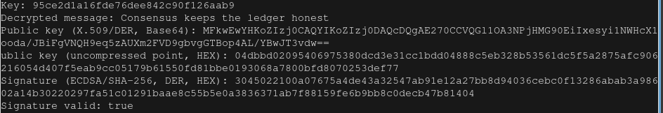

## Output

## Key identification

1. Take the list of candidate AES-128 keys and the expected SHA-256 hash.
2. For each candidate, decode the hex string into 16 raw bytes.
3. Compute the SHA-256 digest of those bytes and format it as hex.
4. Compare the digest with the expected hash.
5. Pick the candidate with matching didgest.

## Decryption

1. Decode the ciphertext and the IV from hex into bytes.
2. Create an `AES/CBC/PKCS5Padding` cipher in decrypt mode, initialised with the identified key and the 16-byte IV.
3. Decode bytes as UTF-8.
